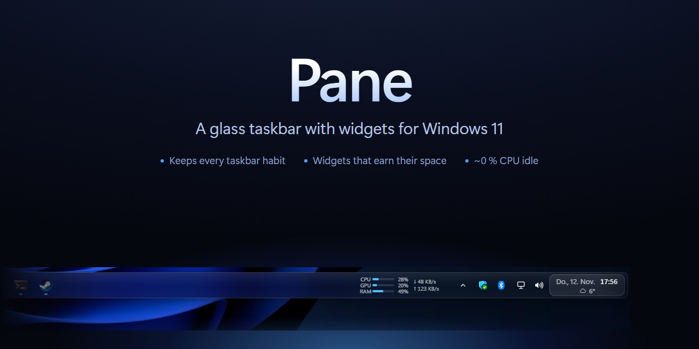
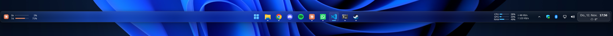

Pane replaces the Windows 11 taskbar with a glass bar that keeps everything the taskbar does and adds small widgets.



## Features
- **Start:** the Windows button opens the real Start menu.
- **Pinned and running apps:** your Windows taskbar pins, then open apps, centered like Windows 11. Click to start, bring to front or minimize. Right-click for the app's windows, "New window" and "Close". Pin new apps from the Start menu (right-click > "Pin to taskbar").
- **Tray icons:** the icons Windows shows on the taskbar, the rest behind the ^ arrow. Click and right-click work as usual. Which icons are visible follows Windows Settings > Personalization > Taskbar > Other system tray icons. Windows' own volume, network and battery icons are left out: Pane shows those itself.
- **Media:** cover, title, artist and play/pause/next for Spotify, YouTube in the browser, or any app that uses the Windows media controls.
- **Claude usage:** your 5-hour and weekly Claude limits with reset times, from Claude Code's login on this PC. Click for the usage page. When Claude Code finishes a task, an orange glow lights up on the widget's left edge (blue for Codex) until you move the mouse over it.
- **Codex usage:** the same for Codex (ChatGPT plan), from the Codex CLI's login. Right-click the bar > "Add Codex login…" to log in.
- **CPU / GPU / RAM:** small meters with the same numbers as Task Manager. Click for Task Manager.
- **Network:** download and upload speed (hidden on narrow screens).
- **Weather:** temperature and an icon under the clock, from your Windows location and Open-Meteo. When it cannot be read (offline, location off), a dim placeholder says so instead of disappearing. Location must be allowed for desktop apps (Settings > Privacy & security > Location).
- **Docker:** while Docker runs, the number of running containers; click for every container with its state, ports and start / stop / restart. Hidden when Docker isn't running.
- **Date and time:** click for notifications and the calendar. The network and volume icons open Quick Settings and the volume mixer. While music plays, small play/pause/next controls pop out of the volume icon on hover.
- **Auto-hide:** the bar can float over apps and slide away; touch the bottom edge to bring it back. It stays up while any menu is open. How long it stays after the mouse leaves and how fast it slides are in the settings window.
- **Adaptive colour:** the bar can match the colour of the apps above it.
- **Settings:** right-click the bar > Settings, which holds three short pages - Bar (auto-hide, fill, adaptive colour), Widgets (Now Playing, Claude, Codex, system load, weather, Docker) and "Show on the bar" (Start, tray, network, volume, battery, time, date); "More settings…" opens the settings window, which also has glass lightness, bar height (small / normal / large) and the auto-hide timing. "Report a bug…" opens a GitHub issue with Pane's version filled in.
- **Starts with Windows:** on from the first start, so Pane is there after a restart. Switch it off in Pane (right-click > Settings) or in Task Manager > Startup apps; both show the same state.
- **Auto-update:** Pane checks GitHub Releases for new versions. A new one shows an "Update x.y.z" pill; click it to install.
- **Every monitor:** one bar per monitor, each with its own windows. Pane hides on a monitor where a fullscreen app or game is in front.

## Install
1. Download `Pane_x.y.z_x64-setup.exe` from [Releases](https://github.com/LouisHD14/pane/releases/latest).
2. Run it. It installs for your user only, no admin needed.
3. Start Pane from the Start menu. To start it with Windows: right-click the bar > "Start with Windows".

Windows SmartScreen may warn because the installer is not code-signed. Click "More info" > "Run anyway".

## Turn it off
- **Quit:** right-click the bar > "Quit Pane". The Windows taskbar comes back at once.
- **Hide / show:** press Ctrl+Alt+P. The Windows taskbar comes back while Pane is hidden.

## Uninstall
Settings > Apps > Installed apps > Pane > Uninstall. The uninstaller closes Pane, brings the taskbar back as it was, and asks whether to delete Pane's data too.

## Safety
The normal taskbar always comes back.
- The only Windows setting Pane changes is taskbar auto-hide. Pane saves the old value first and gives it back on quit, crash, uninstall and next start.
- A small watchdog process brings the taskbar back if Pane crashes or is ended in Task Manager.
- If the taskbar ever stays hidden, run:
  ```
  "%LOCALAPPDATA%\Pane\pane.exe" --restore
  ```
  Or turn off "Automatically hide the taskbar" in Settings > Personalization > Taskbar.

## Privacy
- The Claude and Codex widgets read the logins that Claude Code (`~/.claude/.credentials.json`) and the Codex CLI (`~/.codex/auth.json`) already keep on your PC. Pane never logs them.
- These logins are only sent to Anthropic (`api.anthropic.com`, `platform.claude.com`) and OpenAI (`chatgpt.com`, `auth.openai.com`) to read your usage. When a login has expired, Pane renews it the same way the CLI does and saves it back to the same file.
- Weather uses your rounded location and asks [Open-Meteo](https://open-meteo.com). No key, no account.
- Updates are checked on GitHub.
- The "done" glow reads the end of Claude Code's and Codex's conversation files on your PC (`~/.claude/projects`, `~/.codex/sessions`) when they change. Nothing from them is sent or logged.
- The Docker widget talks to Docker's local pipe only.
- "Report a bug…" opens GitHub in your browser with Pane's version and the Windows build; nothing is sent until you submit it there.
- Nothing else leaves your PC. Settings and logs stay in `%LOCALAPPDATA%\org.gruening.pane`.

## Build from source
Needs Node.js 22+, Rust (rustup) and the Visual Studio C++ Build Tools.

```sh
npm install
npx tauri build      # installer in src-tauri/target/release/bundle/nsis/
npx tauri dev        # run with live reload of the UI
cd src-tauri && cargo test
```

Build with `npx tauri build`, not `cargo build --release`: plain cargo makes an exe that loads the UI from the dev server and shows an empty bar.

The build ends with an updater signing error if you don't have the release key. The exe and installer are still built.

### Test scripts
These start Pane and hide your taskbar for a few seconds. Quit your own Pane first.
- `tools/smoke-test.ps1 -Exe <pane.exe>`: checks the taskbar is hidden, kills Pane hard, checks the watchdog brings the taskbar back. Prints RAM and idle CPU.
- `tools/install-test.ps1 -Setup <setup.exe>`: silent install, start, silent uninstall; checks nothing is left behind.
- `tools/fullscreen-test.ps1 -Exe <pane.exe>`: checks the bar hides for a fullscreen window and comes back.
- `tools/tray-test.ps1 -Exe <pane.exe> -Out <prefix>`: counts the tray icons and saves screenshots of the tray popup.

### Release (maintainer)
Needs the updater key at `%USERPROFILE%\.tauri\pane-updater.key`.
1. `tools/release.ps1 -Version x.y.z -Notes "What changed"` bumps the versions, builds the signed installer and writes `latest.json`.
2. Merge the version bump to `main`.
3. Run the `gh release create ...` command the script prints. Not as a prerelease: Pane reads `releases/latest`.

### Layout
```
index.html, src/          Bar UI, popups and settings window (TypeScript, CSS)
src-tauri/src/main.rs     App: one bar per monitor, show/hide, watchdog, commands
src-tauri/src/win.rs      Windows calls: hide/restore taskbar, reserve the screen edge, fullscreen check, send keys
src-tauri/src/apps.rs     Pinned + running apps, icons, activate/close/launch, window events
src-tauri/src/status.rs   Network, volume, battery state
src-tauri/src/tray.rs     Tray icon host (own Shell_TrayWnd, forwards everything to Explorer)
src-tauri/src/media.rs    Now Playing (Windows media controls)
src-tauri/src/weather.rs  Windows location + Open-Meteo
src-tauri/src/usage.rs    CPU / GPU / RAM load and network speed
src-tauri/src/claude.rs   Claude plan limits (Claude Code login, renewed when expired)
src-tauri/src/codex.rs    Codex plan limits (Codex CLI login, renewed when expired)
src-tauri/src/settings.rs Settings (switches, glass lightness, bar height, auto-hide timing), checked and clamped
src-tauri/src/http.rs     Small HTTPS GET/POST (ureq)
src-tauri/src/update.rs   Auto-update from GitHub releases
src-tauri/windows/        Uninstaller hook (closes Pane, restores the taskbar)
docs/                     README images; banner.html renders banner.png
tools/                    Test scripts, release.ps1
```

The plan and design notes are in [`PLAN.md`](PLAN.md).

## License
MIT, see [LICENSE](LICENSE).

## Credits
- Inspired by [LumaBar](https://lumabar.xyz). Pane has its own design and code.
- The tray icon host follows the technique of [ManagedShell](https://github.com/cairoshell/ManagedShell) and [RetroBar](https://github.com/dremin/RetroBar).
- Built with [Tauri](https://tauri.app). Weather data by [Open-Meteo](https://open-meteo.com).
